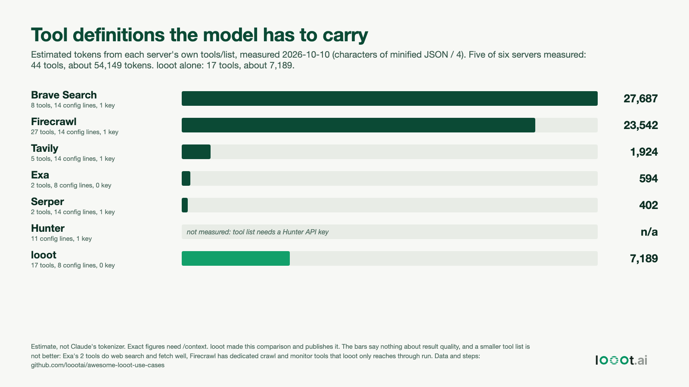

# One entry instead of six MCP servers

Date: 2026-10-10. I work on looot, so I made this comparison and I have a stake in it. Read "What the others do better" before you quote a number.



## Result

| Server | Setup from its own README | Config lines | API keys | Tools | Tool-definition characters | Tokens (estimate) |
| --- | --- | --- | --- | --- | --- | --- |
| Firecrawl `firecrawl-mcp` 3.27.3 | stdio via npx | 14 | 1 | 27 | 94,167 | about 23,500 |
| Tavily `tavily-mcp` 0.2.22 | stdio via npx | 14 | 1 | 5 | 7,694 | about 1,900 |
| Exa, hosted `mcp.exa.ai/mcp` 3.4.2 | remote URL | 8 | 0 (key optional) | 2 | 2,377 | about 600 |
| Brave Search `@brave/brave-search-mcp-server` 2.1.4 | stdio via npx | 14 | 1 | 8 | 110,749 | about 27,700 |
| Serper `serper-search-scrape-mcp-server` 0.1.2 (community) | stdio via npx | 14 | 1 | 2 | 1,606 | about 400 |
| Hunter, hosted `mcp.hunter.io/mcp` | remote URL plus key header | 11 | 1 | not measured | not measured | not measured |
| looot, `api.looot.ai/mcp` | remote URL, browser sign-in | 8 | 0 | 17 | 28,757 | about 7,200 |

Totals for the six: 55 config lines if all six entries sit in one `.mcp.json`, 5 API keys, and for the five measured servers 44 tools, 216,593 characters, about 54,000 tokens. looot: 8 lines, no pasted key, 17 tools, about 7,200 tokens. The five measured servers carry about 7.5 times the tool-definition text of looot.

The spread inside the six is larger than the gap to looot. Brave's `brave_place_search` alone is 77,365 characters, more than looot's whole list. Exa, Tavily and Serper together are about 12,000 characters, less than half of looot's.

## How each number was measured

- Tools and characters. Each server was asked for `tools/list` over MCP and the reply saved to `data/<server>.tools.json`. Characters are the length of the tool objects as minified JSON (name, description, input schema).
  - Firecrawl, Tavily, Brave, Serper: the npm package was installed with `--ignore-scripts` into a scratch folder (exact pins, checked with pin-guard first) and started over stdio with a fake API key. No real key was used. `scripts/mcp_stdio_tools_list.py` does this.
  - Exa: the hosted server answers `tools/list` with no key. `scripts/mcp_tools_list.py` does this.
  - Firecrawl hosted (`mcp.firecrawl.dev/mcp`, keyless session) exposes only 3 tools (`data/firecrawl-hosted.tools.json`). The 27 above come from the npm package, the setup its README gives. Different setup, different count.
  - looot: its tool list needs a sign-in, so `tools/list` was not called. `scripts/parse_looot_tools.py` rebuilds each tool from the public tool docs (`https://api.looot.ai/llms-full.txt`, saved as `data/looot-llms-full-2026-10-10.txt` with one third-party email address in an example removed): name, description text and input schema. If the live description differs from the doc text, the number moves. The two operator-only tools are left out. The docs disagree on the count: `llms-full.txt` says 17 tools including `feedback`, the docs page table lists 16 and its sentence says 15. I counted 17.
  - Hunter: the hosted server needs an API key to answer, and Hunter's docs do not list its tools. Not measured. The old `hunter-io/hunter-mcp` repo is deprecated and listed six tools, but that is not the hosted server.
- Tokens. Characters divided by 4. This is a rough ratio, not Claude's tokenizer. The exact figure is what `/context` shows. See `capture-context.md` for how to take that screenshot.
- Config lines. The entry as each README shows it (versions pinned by me), written as a `.mcp.json` block with 2-space indent, wrapper included. The count depends on formatting, so read it as a rough size. `results.json` has each entry.
- Brave: default tool set. Brave's README describes flags to enable fewer tools. I did not try them.

## What the others do better

- Exa, Tavily and Serper expose a few tools with short definitions. Each costs under 2,000 tokens. If you need web search and page fetch only, one of them is a smaller footprint than looot.
- Firecrawl has dedicated tools for crawl, map, monitors, agent runs and interactive sessions. looot reaches comparable endpoints through `run` on a catalog endpoint, with fewer purpose-built tools.
- Brave has local, image, video and news search plus its own LLM context endpoint under one key and one provider's behaviour to learn.
- Hunter's server is built around one product and its full feature set. looot offers Hunter's endpoints as some of several email providers.
- A single provider means one bill and one support contact. looot adds a layer between you and the provider.

What looot adds is one prepaid balance across 90+ providers, the price shown before a run, and no charge for a failed call. None of that shows in a tool-token count.

## Reproduce

```bash
# 1. remote servers, no key
python3 -I scripts/mcp_tools_list.py https://mcp.exa.ai/mcp data/exa.tools.json
python3 -I scripts/mcp_tools_list.py https://mcp.firecrawl.dev/mcp data/firecrawl-hosted.tools.json
# 2. npm servers: install pinned, no install scripts, then start with a fake key
mkdir probe && cd probe && npm init -y
npm install --save-exact --ignore-scripts firecrawl-mcp@3.27.3 tavily-mcp@0.2.22 @brave/brave-search-mcp-server@2.1.4 serper-search-scrape-mcp-server@0.1.2
cd ..
python3 -I scripts/mcp_stdio_tools_list.py data/firecrawl.tools.json FIRECRAWL_API_KEY=fake -- node probe/node_modules/.bin/firecrawl-mcp
python3 -I scripts/mcp_stdio_tools_list.py data/tavily.tools.json TAVILY_API_KEY=fake -- node probe/node_modules/.bin/tavily-mcp
python3 -I scripts/mcp_stdio_tools_list.py data/brave.tools.json BRAVE_API_KEY=fake -- node probe/node_modules/.bin/brave-search-mcp-server
python3 -I scripts/mcp_stdio_tools_list.py data/serper.tools.json SERPER_API_KEY=fake -- node probe/node_modules/.bin/serper-mcp
# 3. looot from its public docs
curl -s https://api.looot.ai/llms-full.txt -o data/looot-llms-full-2026-10-10.txt
python3 -I scripts/parse_looot_tools.py data/looot-llms-full-2026-10-10.txt data/looot.tools.json
# 4. numbers and chart (analyze.py reads data/ and writes results.json in the current folder)
python3 -I scripts/analyze.py && python3 -I scripts/make_chart.py
"/Applications/Google Chrome.app/Contents/MacOS/Google Chrome" --headless=new --window-size=1600,900 --screenshot=chart.png file://$PWD/chart.html
```

Package versions move. Firecrawl 3.29.1 was one day old when I ran this, so I pinned 3.27.3, the newest release older than a week. Newer versions may list a different number of tools.

## Not done

- No `/context` screenshot. I ran no interactive Claude Code session. `capture-context.md` has the 3 steps.
- No tool calls to any provider, so nothing here says which server returns better results or costs less per call.
- Hunter's tool count and size.
