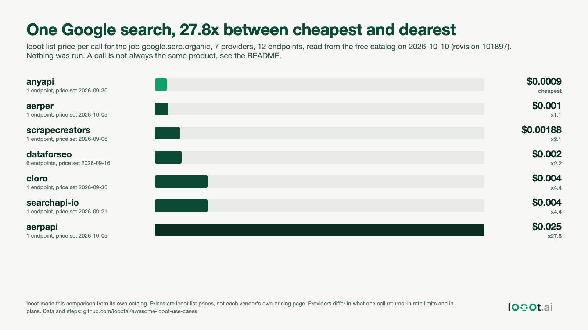

# The same Google search at 7 providers: $0.0009 to $0.025 a call

Date: 2026-10-10. I work on looot, and looot sells access to these providers, so I made this table with a stake in it. Nothing was run. Every price is read from looot's free public catalog.



## Result

Job `google.serp.organic` ("Get Google search results for a query or keyword"). Catalog revision 101897, built 2026-10-10T09:47Z. 7 providers, 12 endpoints.

| Provider | Endpoints | looot list price per call | Per 10,000 calls | Times the cheapest | Price set on |
| --- | --- | --- | --- | --- | --- |
| anyapi | 1 | $0.0009 | $9.00 | 1.0 | 2026-09-30 |
| serper | 1 | $0.001 | $10.00 | 1.1 | 2026-10-05 |
| scrapecreators | 1 | $0.00188 | $18.80 | 2.1 | 2026-09-06 |
| dataforseo | 6 (all the same price) | $0.002 | $20.00 | 2.2 | 2026-09-16 |
| cloro | 1 | $0.004 | $40.00 | 4.4 | 2026-09-30 |
| searchapi-io | 1 | $0.004 | $40.00 | 4.4 | 2026-09-21 |
| serpapi | 1 | $0.025 | $250.00 | 27.8 | 2026-10-05 |

Spread: $0.025 / $0.0009 = 27.8 times. The median provider is $0.002, so serpapi is 12.5 times the median and the cheapest is 0.45 times it. Six of the seven sit within 4.4 times of each other. One provider is the outlier.

Per-endpoint rows are in `prices.csv`. The summary is in `summary.json`.

## How the numbers were read

1. `GET https://api.looot.ai/v1/catalog/overview?depth=jobs` gives the job and its counts (7 providers, 12 endpoints, cheapest per call 0.0009). The relevant slice is saved as `data/catalog-overview-jobs-google.serp.organic-2026-10-10.json`.
2. `GET https://api.looot.ai/v1/public-catalog?capability=google_serp_organic&limit=50` returns the 12 endpoints with `price.amountMicros` (1,000,000 micros = $1), `price.unit` (every one is `call`) and `price.effectiveAt`. Saved as `data/public-catalog-capability-google_serp_organic-2026-10-10.json`. The count matches step 1.
3. `GET .../public-catalog?q=google+search&limit=50` was also read (`data/public-catalog-q-google-search-2026-10-10.json`, one support email address in an endpoint description removed) to look for Google search endpoints under other capability names. The first page holds only the same 12 plus other jobs (ads, news, maps, images). The query has more pages that I did not walk, so this is a spot check, not a full proof that no other endpoint answers the same question.
4. `scripts/analyze.py` turns the saved file into `prices.csv` and `summary.json`. `scripts/make_chart.py` writes `chart.html`, and headless Chrome renders `chart.png`.

## What this table does not say

- These are looot list prices. They are not each vendor's own pricing page, and I did not check the vendors' pages. A vendor's own price on a monthly plan can be lower or higher, and volume tiers and free allowances do not show here.
- "One call" is not the same product everywhere. From the catalog descriptions:
  - serper and anyapi return about 10 organic results with the common SERP blocks. Serper says `num` up to 100 still costs 1 credit.
  - dataforseo has a plain ranked list (`regular`), the full page with blocks (`advanced`) and raw HTML (`html`) at the same price.
  - scrapecreators returns title, URL and description per result, pages 1 to 11.
  - serpapi returns raw JSON with organic results, knowledge graph, answer box, local results and ads.
  - searchapi-io returns organic results plus ads and knowledge graph. The catalog says it is charged per search even when no results come back.
  - cloro returns a parsed SERP including People Also Ask, local pack and ads. It bills 5 credits for page 1 and 2 more for each extra page, so its $0.004 is for page 1 only.
- Latency, success rate and result quality were not measured. A cheap call that fails or returns a stale page is not cheap. The catalog marks every one of these 12 endpoints `unverified`.
- The catalog changes. Prices carry the date they were set. Re-read before you rely on a number.

## What a direct account can do that this cannot

Going to a provider directly gives you its own dashboard, its own rate limits and plans, and support from the company that runs the service. looot adds a layer on top. In return looot shows the price before a call, bills one prepaid balance and charges nothing for a failed call. I do not know yet that those trade-offs suit your volume.

## Reproduce

```bash
curl -s 'https://api.looot.ai/v1/catalog/overview?depth=jobs' -o overview.json
curl -s 'https://api.looot.ai/v1/public-catalog?capability=google_serp_organic&limit=50' \
  -o data/public-catalog-capability-google_serp_organic-2026-10-10.json
python3 -I scripts/analyze.py        # prices.csv, summary.json (from this folder)
python3 -I scripts/make_chart.py
"/Applications/Google Chrome.app/Contents/MacOS/Google Chrome" --headless=new --window-size=1600,900 --screenshot=chart.png file://$PWD/chart.html
```

`analyze.py` also reads `data/catalog-overview-jobs-google.serp.organic-2026-10-10.json`, which holds the `google.serp.organic` entry and the catalog revision from `overview.json`. Prices will differ from this README if you run it later. That is the point of the dated files.
