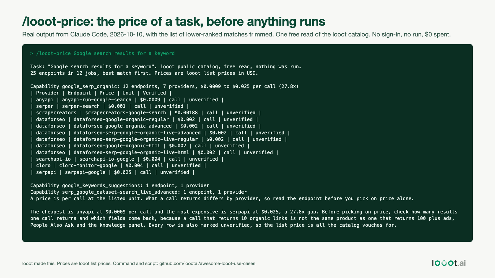

# /looot-price: see every provider and price before Claude Code spends anything

Date: 2026-10-10. I work on looot. This is a slash command for Claude Code that reads looot's free public catalog and prints the providers and prices for a task. It runs no endpoint and spends nothing.



## What it does

`/looot-price <task in plain words>` runs one `GET https://api.looot.ai/v1/public-catalog?q=<task>&limit=25`. The catalog needs no token and no sign-in. The command prints the best-matching job as a table (provider, endpoint id, price per call, unit, verification state) with the cheapest-to-dearest multiple, lists other matching jobs in one line each, and asks Claude to add three sentences. It does not call `run` and it does not call any provider.

Two real outputs from this build are in `data/`. Both were produced by `claude -p "/looot-price ..."` in a scratch project:

- `data/sample-claude-code-output-google-search.txt`: 12 endpoints from 7 providers, $0.0009 to $0.025 a call (27.8 times). It matches the Day 2 table (`builds/2026-10-11-google-search-price-spread/`).
- `data/sample-claude-code-output-find-work-email.txt`: 25 endpoints on the first page, cheapest $0.003598 and dearest $0.25 (69.5 times). Only the first page of 25 was read, so more endpoints may exist.

## Install

Into one project:

```bash
mkdir -p .claude/commands
cp command/looot-price.md scripts/looot_price.py .claude/commands/
```

Then in Claude Code: `/looot-price verify an email address`.

To install it for every project, copy both files to `~/.claude/commands/` and change the two `.claude/commands/` paths in `looot-price.md` to `~/.claude/commands/`. I did not touch my own global setup while building this, so that variant is untested.

You can also run the script alone: `python3 scripts/looot_price.py "find a work email" [--limit N] [--all] [--json]`. It needs Python 3 and the standard library only.

## How the command stays read-only

- `allowed-tools` in the command file lets Claude run one thing: `python3 .claude/commands/looot_price.py`.
- The script sends one GET to a public endpoint with no Authorization header. There is no token in the repo or in the request.
- The command text tells Claude not to call `run` or any provider. That part is an instruction to the model, not a technical block. If you also have the looot MCP server connected, nothing in this command removes its `run` tool. A permission rule or a hook is the thing that enforces a spending limit. A hook that does it is planned for a later build.

## Limits

- Search is the catalog's own text ranking. A vague task can return a different job than the one you meant. The one-line list of other jobs is there for that case.
- Prices are looot list prices from the catalog at the time of the call. The output carries no date of its own beyond "just now". Re-read before a batch.
- "Per call" is not the same product everywhere. See the Day 2 README for how the Google search endpoints differ.
- Every endpoint in these samples is `unverified` in the catalog, so a price says nothing about how well the endpoint works.
- Tested for real only with `claude -p` in a scratch project. I did not record the interactive session, so there is no clip yet.

## Not done

- A 30-second screen clip of the command in an interactive session. Walid records it: run `/looot-price Google search results for a keyword`, show the table, stop.
- The global install variant (see above).

## Reproduce

```bash
# from this folder
mkdir -p demo/.claude/commands
cp command/looot-price.md scripts/looot_price.py demo/.claude/commands/
(cd demo && claude -p "/looot-price Google search results for a keyword" --max-turns 3)
python3 -I scripts/make_image.py   # renders image.html from data/sample-claude-code-output-google-search.txt
```
