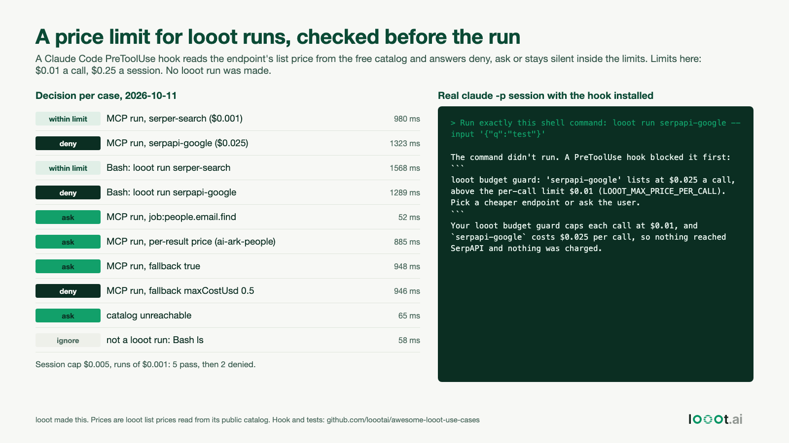

# A price limit for looot runs, enforced by a Claude Code hook

Date: 2026-10-13 (plan day 8, built 2026-10-11). I work on looot. This is a hook for Claude Code that reads the list price of a looot endpoint from the free public catalog before the run and blocks it when it is over a limit you set. looot also has its own workspace balance check on every run. This hook is a separate, client-side limit for one agent session.



## Result

- A run of `serpapi-google` (list price $0.025 a call) with a $0.01 per-call limit was blocked in a real `claude -p` session. Claude Code reported that the command did not run. The workspace run list showed no run created on 2026-10-11.
- 23 replayed hook payloads gave the decision I expected in every case (table below). Median time for a decision that needs a catalog read was 1,025 ms (range 863 to 1,568 ms over 17 cases). The 6 cases that need no catalog read took 52 to 218 ms.
- The session cap works: with a $0.005 cap and $0.001 runs, runs 1 to 5 passed and runs 6 and 7 were denied.

| Case | Decision |
| --- | --- |
| MCP `run`, `serper-search` ($0.001) | silent, within limits, adds to session total |
| MCP `run`, `serpapi-google` ($0.025) | deny, above the per-call limit |
| `looot run serper-search` in Bash | silent, within limits |
| `looot run serpapi-google` in Bash | deny |
| free endpoint ($0) | silent |
| `job:people.email.find` | ask, a job id has no single price |
| `ai-ark-people` (priced per result) | ask, the total depends on how many results come back |
| `fallback: true` with no `maxCostUsd` | ask, other providers may be tried at other prices |
| `fallback.maxCostUsd` 0.5 | deny, 0.5 is above the limit |
| `fallback.maxCostUsd` 0.005 | silent |
| endpoint that does not exist | ask |
| catalog unreachable | ask (set `LOOOT_UNKNOWN_PRICE=deny` to block instead) |
| `LOOOT_UNKNOWN_PRICE=deny`, job id | deny |
| `ls`, an Edit call, `inspect` | no opinion |

Every row, with the reason text and the milliseconds, is in `data/test-results.json`.

## How it works

Claude Code runs a PreToolUse hook before a tool call and reads a JSON decision from its stdout. `hook/looot_budget_guard.py`:

1. Recognizes a looot run: the MCP tool whose name starts with `mcp__`, contains `looot` and ends with `__run`, or a Bash command containing `looot run <endpoint-id>`.
2. Reads `GET https://api.looot.ai/v1/public-catalog/<endpoint-id>` (free, no token). It uses `price.amountMicros` only when `price.unit` is `call`.
3. Denies when the price is over `LOOOT_MAX_PRICE_PER_CALL` (default $0.01) or when the allowed runs of this session would pass `LOOOT_SESSION_CAP` (default $0.25). It asks when the price cannot be known. Otherwise it stays silent so your normal permission rules decide whether to prompt. Set `LOOOT_AUTO_ALLOW=1` to approve in-limit runs without a prompt.
4. Keeps the session total in `~/.local/state/looot-budget-guard/<session_id>.json`. If the hook itself crashes it answers `ask`, because a crashed hook would otherwise let the run through.

Python 3 standard library only. No token is read or sent. The catalog read adds about a second to each looot run.

## Install

```bash
mkdir -p .claude/hooks
cp hook/looot_budget_guard.py .claude/hooks/
cp hook/settings.example.json .claude/settings.json   # or merge the "hooks" block into your own
```

Change the two limits in the `command` string of the settings file. The matcher `Bash|mcp__.*looot.*__run` also fires on every Bash call, which costs a few milliseconds when the command is not a looot run.

## Limits

- It counts list prices of runs it allowed. A run that fails costs nothing at looot, so the real bill can be lower. For a `unit: call` endpoint it is never higher. For endpoints priced per `result` (190 of 2,590 in today's catalog) it cannot know the total, so it asks.
- Price is not the same as harm. 186 endpoints in today's catalog cost $0, and some of them act on a connected account (for example adding contacts to a sequence). This hook does not gate side effects. Use a permission rule for those.
- The "within limits" path and the session total were tested with replayed payloads, not in a live looot MCP session. I did not run a real looot call, because that costs money. The real `claude -p` test covers the deny path through the Bash route only. The MCP route is tested with payloads shaped like Claude Code's hook input, and I did not confirm the exact tool name of your MCP install. Check yours with `/mcp` and adjust the matcher.
- Concurrent tool calls are serialized by a file lock, so two parallel runs cannot both slip under the cap.
- A hook is not a security boundary. A model can still call the REST API with `curl` and a token if your permissions allow it.

## Reproduce

```bash
# from this folder
python3 -I scripts/run_tests.py          # writes data/test-results.json, needs network for the catalog reads
mkdir -p demo/.claude/hooks && cp hook/looot_budget_guard.py demo/.claude/hooks/ && cp hook/settings.example.json demo/.claude/settings.json
(cd demo && claude -p "Run exactly this shell command and tell me what happened: looot run serpapi-google --input '{\"q\":\"test\"}'" --max-turns 3 --allowedTools Bash < /dev/null)
python3 -I scripts/make_image.py && python3 -I ../../scripts/render_png.py image.html image.png
```

The `claude -p` output I got is in `data/e2e-claude-p-output.txt` (Claude Code 2.1.296, 2026-10-11). The prices in this README were read from the live catalog on 2026-10-11 by the test run.
