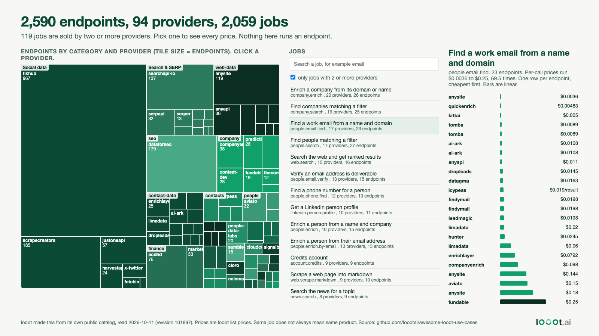

# A map of 2,590 data API endpoints, and the 119 jobs more than one provider sells

Date: 2026-10-14 (plan day 16, built 2026-10-11). I work on looot, so this is a map of looot's own catalog, read from its free public API. Nothing was run and no account is needed.



Open `map.html` in a browser. It is one file with the data inside, no network calls. Click a tile to filter jobs by provider, search a job, click a job to see every endpoint and price.

## Result

Read on 2026-10-11, catalog revision 101897 (built 2026-10-11T09:52Z).

| Measure | Value |
| --- | --- |
| Endpoints | 2,590 |
| Providers | 94 |
| Jobs (capabilities) | 2,059 |
| Jobs with exactly one provider | 1,940 |
| Jobs with 2 or more providers | 119 |
| Jobs with 5 or more providers | 20 |
| Providers that hold half of all endpoints | 3 (tikhub 967, scrapecreators 185, dataforseo 179, together 51.4%) |
| Endpoints priced per `call` / per `result` | 2,400 / 190 |
| Endpoints listed at $0 | 186 |
| Endpoints marked `unverified` | 2,590 (all) |

Price spread, for the 94 jobs where at least two providers have a per-call price above $0. For each provider I took its cheapest per-call endpoint for the job, then divided the dearest provider by the cheapest.

- Median spread is 6.9 times.
- 71 of the 94 jobs have a spread of 2 times or more, 43 have 10 times or more, 5 have 100 times or more.
- Among jobs with 5 or more providers the widest are `people.phone.find` (12 providers, $0.00483 to $0.7194, 148.9x), `people.enrich` (110.3x), `jobs.search` (105.6x), `company.enrich` (20 providers, $0.0019 to $0.196, 103.2x), `people.email.verify` (13 providers, $0.00145 to $0.14388, 99.2x) and `people.email.find` (17 providers, $0.003598 to $0.25, 69.5x). The full list is in `data/summary.json`.

Most of the catalog is a single-provider job. 94% of jobs have one provider, so for most tasks there is nothing to compare. The price spread only exists where providers overlap.

## What this does not say

- A big spread is not proof of a rip-off. The same job id does not always mean the same product. A $0.25 email finder may search more sources or return more fields than a $0.0036 one. I did not compare outputs. Day 2 of these builds shows the Google search case, where one call returns different amounts at different providers.
- The catalog marks every endpoint `unverified`. I measured no latency, no success rate and no result quality.
- Prices are looot list prices, not each vendor's own pricing page. A vendor's monthly plan can be cheaper per call at volume.
- Grouping by job uses the catalog's `capabilities` field with `_` turned into `.`. That matches the job ids in the overview for 2,058 of 2,059 capabilities. `brand.retrieve-by-email` has endpoints but is missing from the overview, and for `company.enrich` the overview counts 27 endpoints where the public catalog read returned 26. I did not find out why.
- Tile size is endpoint count. One provider with 900 endpoints on one platform (tikhub) says nothing about how much anyone uses it.
- `map.html` is laid out for a 1600 px wide window.

## How the numbers were read

1. `scripts/fetch.py` walks `GET https://api.looot.ai/v1/public-catalog?limit=50&cursor=...` for all 52 pages (2,590 endpoints, the same count as `totals.endpoints` in the overview) and `GET /v1/catalog/overview?depth=full`. It keeps provider, endpoint id, capabilities, category, price, unit, price date and verification state. Descriptions are dropped.
2. `scripts/analyze.py` groups endpoints by job and writes `data/summary.json` and `data/jobs.json`.
3. `scripts/make_map.py` fills `scripts/map_template.html` and writes `map.html`. `image.png` is a Playwright Chromium screenshot of `map.html` at 1600x900 with the job `people.email.find` open.

## Reproduce

```bash
# from this folder, needs Python 3 and network
python3 -I scripts/fetch.py && python3 -I scripts/analyze.py && python3 -I scripts/make_map.py
python3 -I ../../scripts/render_png.py map.html image.png
```

Counts and prices will differ from this README if you run it later. The dated files in `data/` are the snapshot behind the numbers above.
