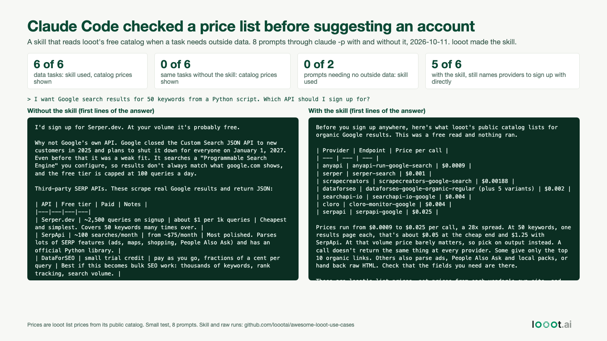

# A skill that makes Claude Code check a price list before it suggests another API signup

Date: 2026-10-15 (plan day 17, built 2026-10-11). I work on looot, and this skill reads looot's catalog, so it points at looot first. It says so in its own instructions and tells Claude to treat signing up with a provider directly as a normal option.



## Result

I ran 8 prompts through `claude -p` (Claude Code 2.1.296, model claude-opus-5-5 as reported by the session), each twice. In the first condition the skill is installed. In the second it is not. Only project settings were loaded and no MCP servers, so my own skills and tools did not leak in. In the "with" runs the only allowed tools are the skill and its one script. No looot token was available and nothing could be run.

| | Skill installed | No skill |
| --- | --- | --- |
| 6 prompts that need outside data (find an email, Google results, verify emails, read pages, tech stack, news): skill used and catalog price table shown | 6 of 6 | 0 of 6 |
| 2 prompts that need no outside data (rename a variable, explain a hook): skill used | 0 of 2 | 0 of 2 |
| Final answer still names providers to sign up with directly | 5 of 6 | 6 of 6 |
| Median final answer length, data prompts | 363 words | 340 words |
| Median turns / seconds, data prompts | 4 turns, 20.1 s | 1 turn, 13.8 s |
| Median cost reported by Claude Code, data prompts | $0.1513 | $0.1231 |

So the skill adds about 3 turns, about 6 seconds and about $0.03 of model cost per question here, and it puts a price table in front of the user. That is 6 questions per condition, so treat the percentages as "it worked in this small test", not as a rate.

Without the skill, the answers quoted vendor prices from memory ("about $1 per 1k queries", "from ~$75/month") and told the user to check pricing pages. With it, the numbers in the table are looot list prices read seconds earlier from the catalog. The skill does not check any vendor's own page, so for a direct signup the user still has to.

## What I checked and how

`scripts/run_eval.py` runs the 16 sessions and saves each stream-json under `data/runs/`. `scripts/analyze.py` scores them with plain string checks, not a judge model:

- skill used: a `Skill` tool call to `before-you-sign-up`
- script ran: a Bash call to `looot_price.py`
- prices shown: a `$0.0...` figure in the final text
- names providers: a word match against a list of 29 vendor names in the script

Scores are in `data/scores.json`. The final answer of every run is in `data/answers/` so you can read them yourself. I did not fact-check what the models said about vendors, free tiers or who holds a job title, so treat the raw answers as model output.

## Limits

- Small test. 6 data prompts and 2 controls, one run each, in a clean scratch project. Another day or another prompt may behave differently. Skill triggering depends on the description text, and my prompts were written by me after the skill.
- The catalog search is text ranking. For "recent news about a company" the table led with a stock-ticker news endpoint at $0.000033 a call, and the answer's "300x spread" compares different products. The answer did say so, but the lesson is that a price range from a loose job match is not a comparison.
- Every endpoint shown is `unverified` in the catalog. The skill tells Claude to say so.
- The skill does not stop Claude from calling a looot MCP `run` tool if one is connected. For a hard limit see the budget guard hook from 2026-10-13.
- `claude -p` is not the same as an interactive session, and skill auto-invocation can differ.
- It uses the same one-GET script as the `/looot-price` command from 2026-10-12.

## Install

```bash
mkdir -p .claude/skills
cp -r skill .claude/skills/before-you-sign-up
```

Then ask Claude Code a task that needs outside data, for example "I need the work email of a CTO, what should I set up?". For a skill in every project, copy it to `~/.claude/skills/` and change the two script paths in `SKILL.md` (untested).

## Reproduce

```bash
# from this folder, needs Claude Code logged in. 16 sessions, a few minutes
python3 -I scripts/run_eval.py     # makes ../../../e2e-skill/{with,without}, override with EVAL_DIR
python3 -I scripts/analyze.py
python3 -I scripts/make_image.py && python3 -I ../../scripts/render_png.py image.html image.png
```
