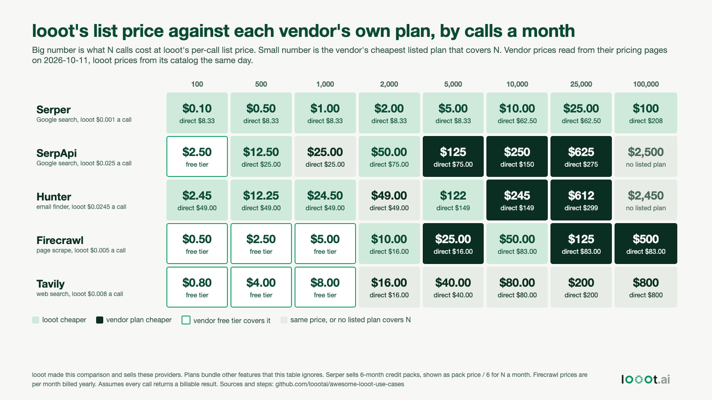

# Your API subscription against per-call prices: where each wins

Date: 2026-10-16 (plan day 25, built 2026-10-11). I work on looot, which sells these providers' endpoints per call, so I made this comparison with a stake in it. Nothing was run. Vendor prices are copied from each vendor's own pricing page. looot prices are read from its public catalog. Both on 2026-10-11.



Open `calculator.html` to put in your own plans. It is one offline file with the catalog's price list inside.

## Result

For 5 vendors with a public price page, I compared N calls a month at looot's list price with the vendor's cheapest listed plan that covers N.

| Vendor | looot endpoint | looot list price | Vendor entry price per unit | Vendor best price per unit (listed plans) |
| --- | --- | --- | --- | --- |
| Serper | `serper-search` | $0.001 | $0.001 (Starter pack, $50 for 50,000 credits) | $0.0003 (Ultimate, $3,750 for 12.5M credits) |
| SerpApi | `serpapi-google` | $0.025 | $0.025 (Starter, $25 for 1,000 searches) | $0.00917 (Big Data, $275 for 30,000) |
| Hunter | `hunter-email-finder` | $0.0245 | $0.0245 (Starter, $49 for 2,000 credits, billed monthly) | $0.01196 (Scale, $299 for 25,000) |
| Firecrawl | `firecrawl-scrape` | $0.005 | $0.0032 (Hobby, $16 a month billed yearly, 5,000 credits) | $0.00067 (Growth, $333 for 500,000) |
| Tavily | `tavily-search` | $0.008 | $0.008 (pay as you go) | not read, the Project plan price is a slider I could not read |

What the table says:

- For four of the five vendors, looot's per-call price equals the vendor's own entry price. For Firecrawl it is higher than every paid plan.
- The vendors' bigger plans cut the per-unit price by 2 to 7.5 times. At volume the vendor's own plan is cheaper. At 10,000 Hunter lookups a month the Growth plan is $149 and the same calls at looot's list price are $245. At 5,000 SerpApi searches the Developer plan is $75 against $125.
- Below the plan sizes, per-call is cheaper because you do not pay for unused allowance. At 500 Hunter lookups a month it is $12.25 against the $49 Starter plan. At 1,000 Serper searches a month it is $1 against about $8.33 (the $50 pack spread over its 6 months).
- Every vendor except Serper has a free tier or free credits: SerpApi 250 searches a month, Hunter 50 credits, Firecrawl 1,000 credits, Tavily 1,000 credits. Serper gives 2,500 free queries once. Inside that, direct costs $0 and looot does not.
- A miss is free at Hunter too: its page says "If the email address can't be found, it's free." A free failed call is not unique to looot.

The full grid is in `data/results.csv` and the crossover points per vendor are in `data/summary.json`. Plan tiers make the "who is cheaper" line zigzag, so read the grid rather than one break-even number.

## What this does not say

- The plans bundle things the per-call price does not. Hunter's $49 plan also includes sequences, Discover and more. SerpApi lists throughput guarantees and legal cover. Vendor support, dashboards and rate limits are not in a per-call price. looot adds one balance, one key and a price shown before each call. I do not know that these are worth more to you than a lower rate.
- Direct accounts have rate limits and features I did not compare. I did not compare what a call returns. Serper and SerpApi calls do not return the same thing, see the 2026-10-11 Google search build.
- Firecrawl shows prices per month billed yearly. The monthly-billed price is not on the page I read, so the Firecrawl column is the cheap case for the vendor.
- Serper's pack handling is my assumption: you use N a month for 6 months, buy the smallest pack covering 6N, and lose what is left. A pack covering a longer period of use changes the cost. Tavily's table cell assumes pay as you go above 1,000 credits and does not read how many credits one search uses.
- I assume every call returns a billable result. A miss is free at looot (a run with no hit is not charged) and at Hunter.
- looot has a $5 minimum top-up and the catalog marks every endpoint `unverified`. Prices are looot list prices, not negotiated.
- Only 5 vendors, picked because their pricing pages were readable by `curl` and each maps to one looot endpoint. This is not a survey.

## How the numbers were read

1. The vendor pages were fetched with `curl` on 2026-10-11 (serper.dev, serpapi.com/pricing, hunter.io/pricing, www.firecrawl.dev/pricing, tavily.com/pricing). The pricing text I used is saved with its URL in `data/sources/`. I typed the plan numbers into `data/vendors.csv` by hand from those excerpts, one row per plan.
2. `scripts/fetch_prices.py` reads `GET https://api.looot.ai/v1/public-catalog/<endpoint-id>` for the 5 endpoints and the whole price list (2,590 endpoints) for the calculator. Output is `data/looot-prices-2026-10-11.json` and `data/catalog-prices-2026-10-11.json`.
3. `scripts/compute.py` applies the rules at the top of the file and writes `data/results.csv` and `data/summary.json`. `scripts/make_image.py` and `scripts/make_calculator.py` write the page files. `image.png` is a Playwright Chromium render of `image.html`.

## Reproduce

```bash
# from this folder
python3 -I scripts/fetch_prices.py && python3 -I scripts/compute.py
python3 -I scripts/make_image.py && python3 -I scripts/make_calculator.py
python3 -I ../../scripts/render_png.py image.html image.png
```

Vendor prices change. `data/vendors.csv` holds the 2026-10-11 numbers, so re-read each page before you rely on this.
