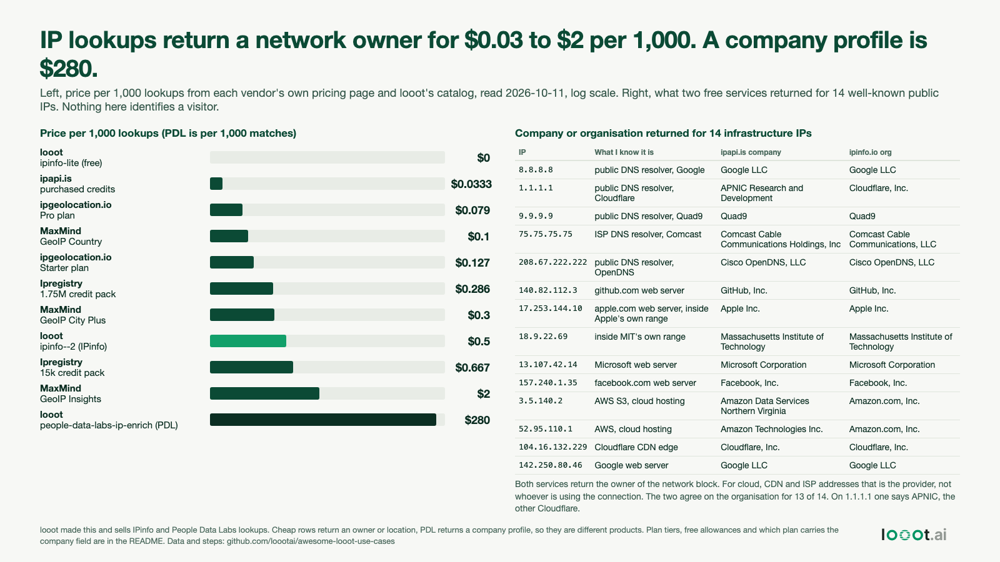

# What an IP-to-company lookup returns, and what it costs

Date: 2026-10-17 (takes the slot of plan day 12, the benchmark protocol, which needs a human sign-off first. Built 2026-10-11). I work on looot, which sells IPinfo and People Data Labs (PDL) lookups, so I made this with a stake in it. Vendor prices are copied from each vendor's own page and looot prices are read from its catalog, all on 2026-10-11. No looot run was made and no website visitor was identified.

This is about the first step of visitor identification, turning an IP address into an organisation. Person-level tools such as RB2B go beyond an IP lookup, and that is out of scope here.



## Result

1. Lookups that return the owner of a network (and a location) cost $0.033 to $2 per 1,000 at the vendors whose pages I read. Most sit between $0.03 and $0.67.
2. A company profile from an IP, People Data Labs through looot (`people-data-labs-ip-enrich`), lists at $0.28 per match, $280 per 1,000 matches. That is 140 times the dearest owner lookup in my table and 560 times looot's own IPinfo endpoint. It is a different product. PDL says it returns company name, domain, industry, size and location, and looot charges only on a match.
3. For 14 public infrastructure IPs, ipapi.is (no key) and ipinfo.io (no token) both returned the owner of the network block. They named the same organisation for 13 of 14. On 1.1.1.1 ipapi.is said "APNIC Research and Development" and ipinfo.io said "Cloudflare, Inc.". For the AWS addresses they gave different Amazon entities. When the address belongs to a cloud host, a CDN or an ISP the answer is that provider. That is the limit of the cheap lookup for identifying visitors: it tells you who owns the network, not who is sitting behind it.

### Price per 1,000 lookups, read 2026-10-11

| Who | Product | Per 1,000 | Source |
| --- | --- | --- | --- |
| looot | `ipinfo-lite` (country and ASN name) | $0 | catalog |
| ipapi.is | purchased credits, $1 for 30,000 requests | $0.033 | ipapi.is page |
| ipgeolocation.io | Pro, $79 a month for 1M credits | $0.079 | their pricing page |
| MaxMind | GeoIP Country, per query | $0.10 | their page, no organisation field |
| ipgeolocation.io | Starter, $19 a month for 150k credits | $0.127 | their pricing page |
| Ipregistry | 1.75M credit pack, $500 | $0.286 | their pricing page, all fields on every plan |
| MaxMind | GeoIP City Plus, adds ISP or organisation | $0.30 | their page |
| looot | `ipinfo--2` (IPinfo) | $0.50 | catalog |
| Ipregistry | 15k credit pack, $10 | $0.667 | their pricing page |
| MaxMind | GeoIP Insights, adds proxy detection | $2.00 | their page |
| looot | `people-data-labs-ip-enrich`, per match | $280 | catalog, price set 2026-09-06 |

`data/prices-per-1000.csv` has the same rows with notes. The page text each number came from is in `data/sources/`.

For scale, RB2B's own pricing page (read 2026-10-11) lists a free plan with company-level identification and 150 resolutions a month, a $79 a month Starter plan, and an overage of 45 cents then 25 cents per resolution on the higher plans. A resolution is not an IP lookup. It is an identified visitor, and RB2B states 15 to 20 percent coverage on the lower plans and 35 to 45 percent on the highest. Those are RB2B's own claims. I did not test them. Excerpt: `data/sources/rb2b-pricing-excerpt.txt`.

## What I did not measure

- Accuracy on real visitors. I looked up server and DNS addresses that I know the owner of, not visitor traffic, and I have no ground truth for any visitor IP. A website's visitors mostly come from ISPs, mobile carriers, VPNs and offices. The 14-IP test shows what the field means, not how often it is right.
- PDL's match rate. I made no PDL call, because the lowest-cost route is a paid run. Whether `ipinfo--2` returns a company field depends on the IPinfo plan looot holds. The catalog says "based on the pricing tier", and I did not test it.
- Which plan of each vendor carries the company field. Ipregistry says it holds no fields back from lower tiers. For ipgeolocation.io I did not re-read the plan table for that field, and MaxMind's own words are "ISP or organization" for City Plus. Terms of use and resale rules were not re-read for this build.
- ipapi.is without a key returns only a company string and an ASN string. Its paid tiers return more fields (type, VPN flags). I did not look at them.
- Prices change. The free tiers, packs and plan sizes are listed on each vendor's page, and a plan can cost less per lookup than a pack.

## Fairness to the tools

The cheap lookups are good at what they do: they are cheap, fast, and fine for filtering out cloud and VPN traffic or finding the country. A company-level tool that sees the same IP will also return the network owner unless it has a firmographic dataset behind it, and that is what the PDL price pays for. looot adds one balance and one key across vendors. I do not know that this matters to you more than going direct.

## How the numbers were read

1. Vendor pages were fetched with `curl` on 2026-10-11. The pricing text I used is saved in `data/sources/` with the URL. I typed the numbers into `data/vendor-prices.csv` by hand.
2. `scripts/analyze.py` reads `GET https://api.looot.ai/v1/public-catalog/<id>` for `ipinfo-lite`, `ipinfo--2` and `people-data-labs-ip-enrich`, and writes `data/prices-per-1000.csv`, `data/summary.json` and `data/looot-prices-2026-10-11.json`.
3. `scripts/sample_ips.py` makes one request per IP to `https://api.ipapi.is/?q=<ip>` and `https://ipinfo.io/<ip>/json`. The roles in the "what I know it is" column are my labels. Output: `data/ip-samples-2026-10-11.json`.
4. `scripts/make_image.py` writes `image.html`. Playwright Chromium renders `image.png`.

## Reproduce

```bash
# from this folder, needs Python 3 and network
python3 -I scripts/analyze.py
python3 -I scripts/sample_ips.py
python3 -I scripts/make_image.py && python3 -I ../../scripts/render_png.py image.html image.png
```
