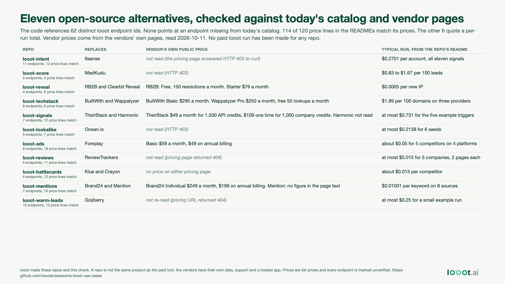

# The eleven open-source alternatives, checked against today's catalog and vendor pages

Date: 2026-10-18 (built 2026-10-11). I work on looot and looot made these repos, so this is an audit of our own claims. I re-read the live catalog and each vendor's public pricing page on 2026-10-11 and compared them with what the repos say. No looot run was made, and none of the eleven repos has had a paid run either, so what follows says nothing about whether the calls work.



## Result

I cloned the default branch of each repo (shallow, commits listed in `data/repos.json`) and checked two things.

1. Endpoint ids. Across `src/`, `config/`, `scripts/` and every json or yaml file, the code names 62 distinct looot endpoint ids (76 counting repeats across repos), from 26 providers. Every one is in today's catalog of 2,590 endpoints. I also looked for quoted strings that start with a provider id and a hyphen but are not catalog ids. There was one, `builtwith-free`, which is a provider key used in tests, not an endpoint id. So I found no dead endpoint id. The check only sees ids written as plain quoted strings, so an id built at run time would be missed.
2. Price lines. In each README and `docs/*.md`, I took every line that holds one endpoint id and one dollar figure. 120 lines: 114 match today's catalog price. The other 6 differ because they show a per-run total, not a per-unit price. Each of the 6 equals the catalog's per-result price times the result count the README states (for example `thecompaniesapi-companies-similar`: $0.0019 x 50 = $0.095). I did that arithmetic by hand, it is not in the script. The details are in `data/repos.json`.

Vendor prices, read on 2026-10-11 from the vendors' own pages (text saved in `data/sources/`):

| Vendor | Public price, 2026-10-11 |
| --- | --- |
| RB2B | Free plan with 150 resolutions a month. Starter $79 a month |
| BuiltWith | Basic $295 a month, Pro $495, Team $995 |
| Wappalyzer | Pro $250 a month, Business $450. Free: 50 technology lookups a month |
| TheirStack | $49 a month for 1,500 API credits. $109 one time for 1,000 company credits |
| Foreplay | Basic $59 a month, $49 on annual billing |
| Brand24 | Individual $249 and $199 listed (the repo says monthly and billed yearly). The labels are not in the text I saved |

Not read: 6sense, MadKudu and Ocean.io answered HTTP 403 to `curl`. The ReviewTrackers and Gojiberry pricing URLs returned 404 on the paths I tried. Klue's, Crayon's and Mention's pages carried no figure in the text I could read. Harmonic was not tried. A page I could not read is not a page with no price.

## Four figures in the index table are stale

The "Open-source alternatives" table in this repo's README does not match the repos' own READMEs on four lines (checked 2026-10-11 against the commits in `data/repos.json`). I did not edit that table.

| Repo | Index says | The repo's README says |
| --- | --- | --- |
| looot-intent | $0.18 per account | $0.2701 per account for all eleven signals ($0.17196 without third-party buying intent) |
| looot-signals | up to $0.53 per run of five triggers | at most $0.731 for the five example triggers ($0.531 for the searches plus $0.20 for founder and investor lookups) |
| looot-ads | about $0.11 for 5 competitors | about $0.05 for five competitors across four platforms |
| looot-mentions | $0.0066 per keyword, six sources | $0.01001 per keyword on eight sources |

## What the vendors have that a repo does not

A repo reads public data through looot's providers on demand. It has no crawler and no data of its own, no hosted app with an account system, no support team and no history. BuiltWith and Wappalyzer run their own crawlers and keep years of technology data. RB2B and 6sense have their own identity and intent data. Foreplay keeps an ad archive and saved boards. A monthly plan also gives you a UI, alerts and integrations that the repos only partly have. The repos win on one thing, which is that you pay per call and see the price before each run. Whether that matters depends on how often you use the tool.

## Limits

- "Match" means the number in a README equals the catalog price on the day. It says nothing about whether the endpoint works. Every endpoint is marked `unverified` in the catalog and none of these repos has been run against it.
- I did not run any repo's tests, build or lint. I installed nothing.
- The "typical run" figures in the image are copied from each repo's README as of the commit I cloned. Other people were still committing to these repos on 2026-10-11, so the figures can move.
- Vendor plans change, and I read only the pages that returned text to `curl`.

## Reproduce

```bash
# from this folder, needs git, Python 3 and network
python3 -I scripts/check_repos.py /path/outside/this/repo/for/clones   # clones the 11 repos shallow, writes data/repos.json
python3 -I scripts/make_image.py && python3 -I ../../scripts/render_png.py image.html image.png
```

`data/catalog-slim-2026-10-11.json` is the catalog snapshot the check reads (made by the 2026-10-14 build's `scripts/fetch.py`). `data/vendor-prices.csv` is typed by hand from `data/sources/`.
