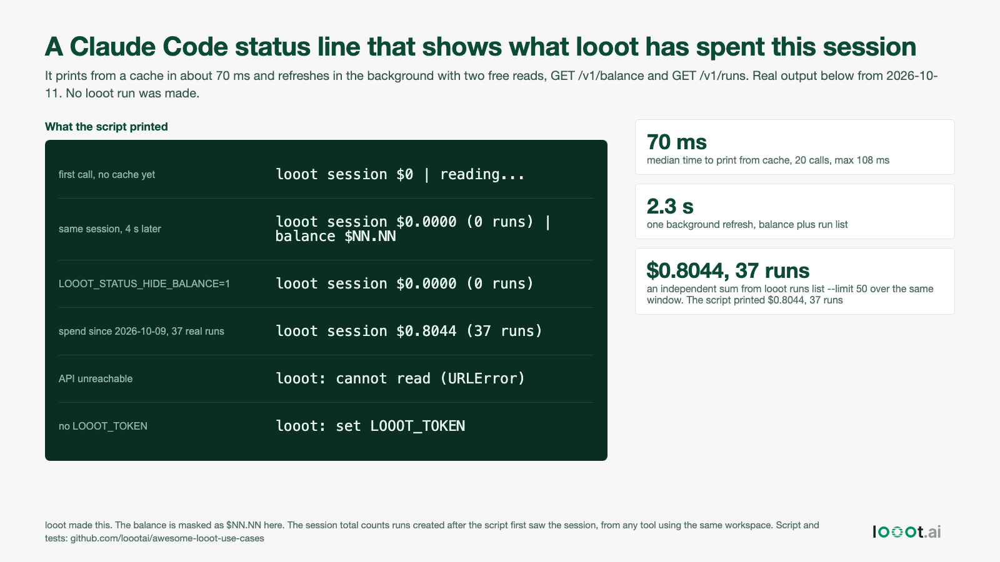

# A Claude Code status line for what this session spent through looot

Date: 2026-10-19 (plan day 20, built 2026-10-11). I work on looot. This is a status line script that shows how much looot has charged since the Claude Code session started, and your balance. It only reads. It makes two free calls, `GET /v1/balance` and `GET /v1/runs?limit=50`, and never runs an endpoint.



## Result

Real output on 2026-10-11, balance masked as `$NN.NN`:

```
looot session $0.0000 (0 runs) | balance $NN.NN
looot session $0.0000 (0 runs)                      (LOOOT_STATUS_HIDE_BALANCE=1)
looot: cannot read (URLError)                       (API unreachable)
looot: set LOOOT_TOKEN                              (no token)
```

- Printing from the cache takes a median of 70 ms (20 calls, 60 to 108 ms). This is Python start-up time. One background refresh, balance plus run list, took about 2 seconds (1.9 to 2.3 s over three measurements).
- The sum is right against an independent count. For a window starting 2026-10-09 00:00 UTC the script printed `$0.8044 (37 runs)`. A separate sum over `looot runs list --limit 50`, with its own date filter, gave $0.80438 over 37 runs. Those are real runs on my workspace, not made for this build. The test could not show a spend inside a live session, because making a run costs money and I made none. In a live session the total starts at $0.0000, which is what the first rows show.
- It never blocks the status line. The first call prints `looot session $0 | reading...` and starts a detached refresh. The next call, a few seconds later, prints the numbers.

## How it works

Claude Code runs the command from `statusLine` in settings, writes a JSON object on stdin (the session id among other fields) and shows the first line of what the command prints. `statusline/looot_statusline.py`:

1. Needs `LOOOT_TOKEN` in the environment. It sends the token only to `api.looot.ai`, and never writes it down.
2. Remembers when it first saw the session id in `~/.local/state/looot-statusline/<session>.json`. That moment is the session start.
3. If the cache is older than 30 seconds it starts a background refresh and prints the old numbers. The refresh adds up `actualCost` of the runs created after the session start (the 50 newest runs) and reads `available` from the balance.
4. Adds `LOW` after the balance when it is under $1. `LOOOT_STATUS_HIDE_BALANCE=1` prints spend only.

Python 3 standard library only.

## Install

```bash
cp statusline/looot_statusline.py ~/.claude/looot_statusline.py      # or into your project's .claude/
export LOOOT_TOKEN=...                                               # the token from `looot token --reveal`
```

Then put this in `~/.claude/settings.json` (a project copy is in `settings.example.json`):

```json
{ "statusLine": { "type": "command", "command": "python3 ~/.claude/looot_statusline.py" } }
```

Claude Code must be able to see `LOOOT_TOKEN` in its environment. Look at the status line after a few seconds, because the first number comes from the first background refresh.

## Limits

- I did not record it inside an interactive Claude Code session. I tested the script with JSON shaped like Claude Code's status line input and against the real API. If a field name in that input has changed, the script still works, because it only uses `session_id` and falls back to a shared session name when it is missing.
- "This session" means runs created after the script first saw the session. Spend before that moment is not counted. It also counts runs made by any other tool on the same workspace during that time, such as the CLI in another terminal or another agent. It is workspace spend during the session, not only Claude's.
- It reads the 50 newest runs. If more than 50 runs happen in the session it prints a `+` after the count and the total is a floor.
- A run still pending may show a cost of 0 until it settles. The cache is 30 seconds old at worst, so the number can lag.
- The balance and the run list belong to the workspace of the token. A token with fewer rights could get a 401 or 403 and the line shows `cannot read`.
- Token handling. The token lives in an environment variable that Claude Code and every command it starts can read. A hook or status line script runs with your user rights, so read the script before you install it. It is 92 lines.

## Reproduce

```bash
# from this folder, needs the looot CLI logged in, Python 3 and network. Makes 4 free reads, no run
python3 -I scripts/run_tests.py
python3 -I scripts/make_image.py && python3 -I ../../scripts/render_png.py image.html image.png
```

`data/test-results.json` has every output and timing. The balance in it is masked.
